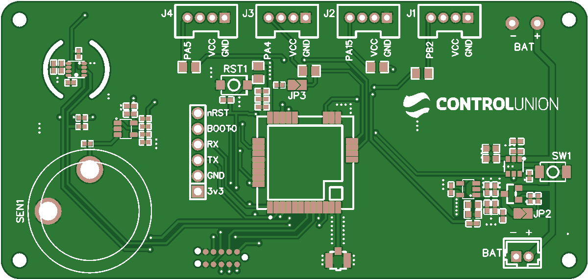

# RAK3172 LoRa Sensor Node (O2 + BME280 + Battery)

Firmware en hardwaredocumentatie voor het custom RAK3172 (STM32WLE5) sensorboard v4.
Functioneel gelijk aan de MKR WAN 1310-firmware
([LoRa_Sensor_Binaire_Upload](https://github.com/alfredkievit/LoRa_Sensor_Binaire_Upload),
branch `fix/o2-low-readings`) en bedoeld als opvolger daarvan.

Deze repository bevat:
- Productie-sketch voor LoRaWAN uplink met 8-byte binaire payload (`PayloadV1`).
- Debug- en kalibratiemodus met warm-up, stabiliteitscheck, flashopslag en temperatuurcompensatie.
- Hardware-overzicht op basis van PCB-topview, schema en BOM.
- Referentiedocumentatie voor bring-up en Node-RED routing.

## Inhoud

- [Overzicht](#overzicht)
- [Repository-structuur](#repository-structuur)
- [Hardware en aansluitingen](#hardware-en-aansluitingen)
- [Bedrijfsmodi](#bedrijfsmodi)
- [O2-kalibratie (klant / veld)](#o2-kalibratie-klant--veld)
- [O2-meting en temperatuurcompensatie](#o2-meting-en-temperatuurcompensatie)
- [Firmwareconfiguratie](#firmwareconfiguratie)
- [Build en upload](#build-en-upload)
- [LoRaWAN payload-formaat](#lorawan-payload-formaat)
- [Node-RED / MQTT integratie](#node-red--mqtt-integratie)
- [Troubleshooting](#troubleshooting)
- [Documentatie](#documentatie)
- [Roadmap](#roadmap)

## Overzicht

Doel van deze node:
- O2, temperatuur, luchtvochtigheid en batterijstatus periodiek verzenden via LoRaWAN (EU868, OTAA, Class A).
- Vast 8-byte payloadcontract, identiek aan de MKR1310-nodes.
- O2 geldig van 0,0 tot 25 %, dus ook in CA-opslag (0,5-3 % O2).
- Kalibratie door de klant zelf: brug plaatsen, reset, wachten.

Laatst bevestigd (2026-10-26, board v4, DevEUI `AC1F09FFFE1DA174`):
- Join + uplink in productie, debugmodus zonder uplinks.
- Kalibratie in buitenlucht: 2,207 V op PB4 bij 20,9 % O2, opgeslagen in flash en na reset weer geladen.

## Repository-structuur

```text
.
|-- RAK3172_Binaire_payload_rui/
|   |-- RAK3172_Binaire_payload_rui.ino
|   |-- arduino_secrets.h            (lokaal, staat in .gitignore)
|   `-- arduino_secrets.example.h
|-- .vscode/
`-- docs/
    |-- images/
    |-- hardware/
    |   |-- BOM_Aalfredkievit_1_v4_2026-02-02.csv
    |   `-- Schematic_Aalfredkievit_1_v4_2026-02-02.pdf
    |-- Gerber_Aalfredkievit_1_v4_PCB_Aalfredkievit_1_v4_2026-02-02.zip
    |-- guides/
    `-- legacy/
```

## Hardware en aansluitingen



- Module: `RAK3172-8-SM-NI` (STM32WLE5), RUI-firmware.
- O2-sensor: Alphasense O2-A2 via OPA333 (100 Ohm shunt, versterking 201).
- BME280 op I2C (adres `0x77`).
- Voeding: TLV75533 (3,3 V) uit VBAT; TPL5110 nano-power timer met P-FET Q1.

### Pinmap (schema v4)

| Signaal | RAK3172-pin | Net / connector | Functie |
|---|---|---|---|
| `BAT_ADC_PIN` | PB3 | A0 | VBAT-deler 470k / 1,5M |
| `O2_ADC_PIN` | PB4 | A1 | uitgang OPA333 (O2) |
| `SERVICE_MODE_PIN` | PA4 | D1, **J3 pin 4** | LOW bij boot = debug + kalibratie |
| `TPL_DONE_PIN` | PA8 | DONE van TPL5110 | wordt LOW gehouden, zie hieronder |
| I2C SDA / SCL | PA11 / PA12 | BME280 | `Wire` standaardpinnen |
| UART2 TX / RX | PA2 / PA3 | header H1 | AT-commando's, upload, debuglog |
| vrij | PA5 | D2, J4 pin 4 | ongebruikt |
| vrij | PB2 / PA10 | A2 (J1) / A3 (J2) | ongebruikt |

J1-J4 (JST, 4-polig): pin 1-2 = 3,3 V, pin 3 = GND, pin 4 = signaal.

### TPL5110 en JP2

PA8 is **geen** sensorvoeding maar de DONE-ingang van de TPL5110. DONE hoog = VBAT uitschakelen tot
het volgende timerinterval. Deze firmware gebruikt RUI-sleep in plaats van de TPL5110:

- **JP2 moet dicht zijn** (TPL5110 overbrugd).
- De firmware houdt PA8 bij boot en daarna altijd LOW.

### UART-converter (TRU COMPONENTS TC-9260976 / CP2102)

3,3 V-logica:
- `TXD 3.3V` -> `RAK UART2_RX (PA3)`
- `RXD` -> `RAK UART2_TX (PA2)`
- `GND` -> `RAK GND`

Niet op modulelogica aansluiten: `TXD 5V`, `VBUS 5V`.

Windows: installeer de Silicon Labs CP210x VCP-driver als de converter in Apparaatbeheer een fout geeft.

## Bedrijfsmodi

De modus wordt **alleen** bij boot bepaald door PA4 (J3 pin 4).

### 1) Productie (PA4 open)

- Geen seriele logging (AT-commando's blijven werken).
- Join (OTAA) + uplink, daarna RUI sleep met batterij-afhankelijk interval:

| Batterij | Interval |
|---|---|
| >= 20 % | 15 min |
| 15-19 % | 4 uur |
| 10-14 % | 6 uur |
| < 10 % | ~60 dagen slapen, geen uplinks (cutoff) |

- Mislukte join (3 pogingen): slapen volgens interval, daarna opnieuw proberen.
- Zonder BME280: O2 en batterij worden toch verstuurd, T/RH als markers (zie payload).

### 2) Debug + kalibratie (PA4 LOW bij boot)

1. Brug **J3 pin 4 -> pin 3 (GND)**, reset (RST-knop of `ATZ`).
2. Seriele log op 115200 baud (COM-poort van de converter).
3. Zelftest open-circuit probe, daarna direct [kalibratie](#o2-kalibratie-klant--veld).
4. Daarna elke 30 s een `DEBUG STATUS` met meetwaarden en payload-preview. **Geen join, geen uplink.**
5. **Na 30 minuten gaat de node zelf naar productie**, ook als de brug blijft zitten. Er volgt geen
   reboot, dus geen tweede kalibratie.

## O2-kalibratie (klant / veld)

Benodigd: de node in schone buitenlucht (20,9 % O2), een draadbrug. Geen laptop nodig.

1. Plaats de brug op **J3 pin 4 naar pin 3**.
2. Druk op **RST** (of zet de voeding aan).
3. Wacht minimaal 2 minuten, maximaal 10 minuten. De firmware:
   - wacht 10 s op optionele invoer van een ander kalibratiegas (alleen met laptop, zie hieronder);
   - doet een warm-up van minimaal 120 s met elke 10 s een gestabiliseerde ADC-meting;
   - kalibreert pas als de laatste 6 meetpunten binnen 5 counts liggen;
   - slaat de referentiespanning **en** de BME280-temperatuur op in flash.
4. Verwijder de brug en druk op **RST**. De node draait nu in productie.

Vergeten de brug te verwijderen? Na 30 minuten gaat de node zelf naar productie.

Let op: elke boot met brug start een nieuwe kalibratie op 20,9 %. Doe dit dus **niet** terwijl de
sensor in een CA-cel of een ander gas hangt.

### Ander kalibratiegas (met laptop)

Open de seriele monitor op 115200 baud en typ binnen 10 s na boot het O2-percentage, bijvoorbeeld
`2.0`, gevolgd door Enter. Nog niet op hardware getest: de seriele poort staat in AT-modus.

### Wat wordt opgeslagen

`CalData` in de RUI user flash (offset 0): magic `'O2CA'`, referentiespanning bij 20,9 % O2,
kalibratietemperatuur, checksum. Ongeldige of ontbrekende data -> fallback `O2_CAL_V_DEFAULT`.

## O2-meting en temperatuurcompensatie

- `O2 % = V_PB4 * 20,9 / V_ref`, met `V_ref` = gekalibreerde spanning bij 20,9 % O2.
- Temperatuurcompensatie volgens Alphasense O2-A2 datasheet (Fig. 1), lineair geinterpoleerd tussen
  -20 en 50 degC, relatief aan de kalibratietemperatuur. Zelfde tabel als de MKR1310-firmware.
- Productie: snelle meting (8 samples). Debug: 3 x gestabiliseerde meting met min/max.
- Geldig bereik 0,0-25 % O2. Er is **geen ondergrens**: lage O2 wordt als waarde verstuurd.
- Onder 50 ADC-counts volgt een open-circuit test (pull-up op PB4 + `digitalRead`). Alleen een
  zwevende ingang geeft `SENSOR_DISCONNECTED`.
- Beperking: een losse of dode cel geeft ~0 V (R15 trekt de opamp-ingang naar GND) en is dus niet te
  onderscheiden van echte 0 % O2.
- Payload: geldige waarden boven 20,0 % worden verstuurd als 20,9 % (zelfde normalisatie als MKR1310).

Resolutie: 1 ADC-count is ongeveer 0,03 % O2.

## Firmwareconfiguratie

Sketch: `RAK3172_Binaire_payload_rui/RAK3172_Binaire_payload_rui.ino`

| Constante | Waarde | Betekenis |
|---|---|---|
| `LORA_FPORT` | `1` | uplinkpoort |
| `LORA_CONFIRMED_UPLINK` | `false` | unconfirmed uplinks |
| `DEBUG_BOOT_WINDOW_MS` | `2000 ms` | tijdvenster om PA4 te detecteren |
| `DEBUG_MODE_MAX_MS` | `30 min` | daarna automatisch naar productie |
| `CAL_GAS_INPUT_TIMEOUT_MS` | `10 s` | invoertijd kalibratiegas |
| `O2_CAL_V_DEFAULT` | `2,207 V` | fallback referentie (gemeten 2026-10-26) |
| `O2_CAL_MIN_WARMUP_MS` / `MAX` | `120 s` / `600 s` | warm-up kalibratie |
| `O2_ADC_LOW_CHECK` | `50 counts` | grens voor open-circuit test |
| `O2_CAL_ADC_MIN_VALID` | `50 counts` | minimaal signaal om te kalibreren |
| `BAT_CUTOFF_PCT` | `10 %` | onder deze waarde geen uplinks meer |

OTAA-sleutels: maak `RAK3172_Binaire_payload_rui/arduino_secrets.h` aan op basis van
`arduino_secrets.example.h` (AppEUI + AppKey). De DevEUI komt uit de module zelf; is die
`0000000000000000`, dan wordt hij afgeleid van de STM32 UID64.

## Build en upload

Vereist: board package `rak_rui:stm32` **4.2.4** via de board-URL
`https://raw.githubusercontent.com/RAKWireless/RAKwireless-Arduino-BSP-Index/main/package_rakwireless_com_rui_index.json`.

### VS Code

De boardconfig staat in `.vscode/arduino.json` (board `WisDuoRAK3172EvaluationBoard`, poort `COM6`).
Pas de poort aan, open de sketch en klik op `Upload`. Sluit eerst andere programma's die de COM-poort
gebruiken.

### Arduino CLI

```bash
FQBN="rak_rui:stm32:WisDuoRAK3172EvaluationBoard:debug=l0,supportat=1,supportlora=2,supportAS923=2,supportAU915=2,supportCN470=2,supportCN779=2,supportEU433=2,supportEU868=1,supportKR920=2,supportIN865=2,supportUS915=2,supportRU864=2,supportLA915=2"

arduino-cli compile --fqbn "$FQBN" --output-dir build/cli ./RAK3172_Binaire_payload_rui
arduino-cli upload -p COM6 --fqbn "$FQBN" --input-dir build/cli ./RAK3172_Binaire_payload_rui
```

De RUI-uploader zet de module zelf in bootmodus via de UART. **BOOT0 is niet nodig** zolang er
RUI-firmware op staat. Bij een lege of kapotte module: STM32 system bootloader via BOOT0 hoog + reset
(zie `docs/guides/RAK3172_Upload_UART_Handleiding.pdf`).

De kalibratie in de user flash blijft na een upload behouden.

## LoRaWAN payload-formaat

Payload is vast 8 bytes (`PayloadV1`, little-endian), identiek aan de MKR1310:

| Offset | Veld     | Type       | Schaal | Ongeldig |
|-------:|----------|------------|--------|----------|
| 0      | msgType  | uint8      | 0x01   | |
| 1..2   | o2_x10   | uint16 LE  | /10    | `65535` (sensor los, verzadigd, > 25 %, geen kalibratie) |
| 3..4   | t_x10    | int16 LE   | /10    | `0x7FFF` (BME280 ontbreekt / onzin) |
| 5..6   | h_x10    | uint16 LE  | /10    | `0xFFFF` (BME280 ontbreekt / onzin) |
| 7      | bat_pct  | uint8      | 0..100 | |

Voorbeeld (2026-10-26):
- Hex: `01D100ED0082015C`
- Decoded: O2 20,9 %, temp 23,7 degC, RH 38,6 %, batterij 92 %

## Node-RED / MQTT integratie

Aanbevolen topic:
- `loranet/application/<app>/device/<devEUI>/rx`

Routeringstrategie:
- Eerst payloadlengte controleren.
- Daarna `msgType` op byte 0 controleren.
- `len=8` + `msgType=0x01` -> binaire sensor decoder.
- Markers `65535` / `0x7FFF` / `0xFFFF` als "niet beschikbaar" behandelen.

## Troubleshooting

| Symptoom | Oorzaak / oplossing |
|---|---|
| Geen COM-poort zichtbaar | CP210x-driver ontbreekt (Apparaatbeheer toont fout) |
| Geen antwoord op `AT` | TX/RX niet gekruist, GND ontbreekt, of BOOT0 hoog |
| Geen seriele log | Normaal in productie; plaats brug J3 en reset |
| Bord valt uit bij meten | JP2 open en PA8 hoog: JP2 dichtmaken |
| O2 altijd ~0 % | Cel los of defect (niet te onderscheiden van 0 % O2) |
| O2 `65535` | Zwevende PB4, ADC verzadigd, > 25 % of geen geldige kalibratie |
| Join mislukt | DevEUI niet geregistreerd in de applicatie of verkeerde AppKey |

DevEUI wijzigen:

```text
AT+DEVEUI=70B3D57ED0061234
```

## Documentatie

- Bring-up gids: [docs/guides/RAK3172_Bringup_Handleiding_Uitgebreid.pdf](docs/guides/RAK3172_Bringup_Handleiding_Uitgebreid.pdf)
- UART upload handleiding: [docs/guides/RAK3172_Upload_UART_Handleiding.pdf](docs/guides/RAK3172_Upload_UART_Handleiding.pdf)
- Node-RED routing bijlage: [docs/guides/RAK3172_NodeRED_Bijlage_PayloadRouting.pdf](docs/guides/RAK3172_NodeRED_Bijlage_PayloadRouting.pdf)
- Hardware BOM v4: [docs/hardware/BOM_Aalfredkievit_1_v4_2026-02-02.csv](docs/hardware/BOM_Aalfredkievit_1_v4_2026-02-02.csv)
- Hardware schema v4: [docs/hardware/Schematic_Aalfredkievit_1_v4_2026-02-02.pdf](docs/hardware/Schematic_Aalfredkievit_1_v4_2026-02-02.pdf)
- Gerber bestanden: [docs/Gerber_Aalfredkievit_1_v4_PCB_Aalfredkievit_1_v4_2026-02-02.zip](docs/Gerber_Aalfredkievit_1_v4_PCB_Aalfredkievit_1_v4_2026-02-02.zip)
- Legacy VS Code notities: [docs/legacy/README_VSCODE.md](docs/legacy/README_VSCODE.md)

## Roadmap

- Test bij lage O2 (N2 of kalibratiegas 2 %).
- Tweepuntskalibratie (nul + span) voor betere nauwkeurigheid in CA-bereik.
- Kalibratiefeedback zonder laptop: LED op J4 (PA5), 2x knipperen bij start, 5x bij opslaan.
- Stroomverbruik in slaap meten; eventueel TPL5110-cyclus (JP2 open) als alternatief.
